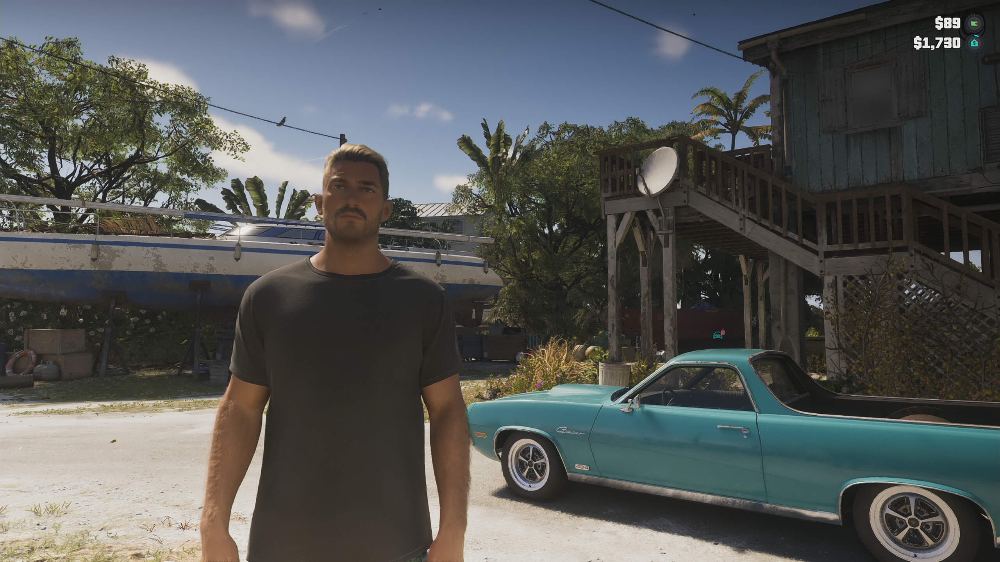

# meyra

shows a game console on a mac through an hdmi capture card. little delay, a cleaner and sharper picture, and
generated in-between frames for 30 fps games.

| off | on |
|---|---|
|  |  |

same frame, straight from the capture card and with dither removal, metalfx upscale and sharpening. click for
full size.

i made it to get more fps out of my xbox series s. the game i play runs at 30, and i wanted it to look and move
better on the mac's screen. the idea comes from [veyra-nrvideo](https://github.com/Likely7/Veyra-NRVideo), which
does this on windows. meyra is the mac counterpart, written from scratch on apple's own frameworks.

this is a dev release. it works well on my setup, expect rough edges on yours.

## what it does

- **low delay.** every frame is drawn as soon as it arrives. about 25 ms from capture to screen with frame
  generation off.
- **frame generation.** a 30 fps game arrives as 60 hz with every frame sent twice. meyra swaps each repeat for a
  frame generated between the two real ones (apple's low latency frame interpolator), so it moves like 60 fps.
  costs about 30 ms of extra delay.
- **cleaner picture.** removes the fine dither pattern many games add, upscales to the window with metalfx (or
  an edge-aware shader, or apple super resolution) and sharpens brightness only, with a limit so there are no halos.
- **correct levels.** video range and full range are detected on their own.
- **sound in step.** the source's audio is played delayed to match the picture.
- **even motion.** switches the display, while it runs, to a refresh rate the source divides into evenly.
- **a normal window.** discord, obs and screen sharing can pick it as a source, picture and sound.

## install

1. grab `Meyra-vX.Y.Z.zip` from the [releases page](https://github.com/k33bs/meyra/releases).
2. unzip it and drag `Meyra.app` into applications.
3. open it. macos will refuse the first time, because the app is not signed with an apple developer id. go to
   system settings > privacy & security, scroll down and click "open anyway", then confirm.
4. plug in the capture card with the console on. meyra picks it up, or asks which one if there are several.
5. on the standard capture route macos asks for camera and microphone access. say yes to both, a capture card
   counts as a camera and its sound as a microphone. the blackmagic driver route asks for nothing.

after that it updates itself, see [updates](#updates). or build it yourself, see [building](#building).

## what you need

| what | needs |
|---|---|
| meyra | a mac with apple silicon, macos 14 or later |
| frame generation | macos 26 or later. without it the menu item is greyed out, the rest works |
| apple super resolution | macos 26 or later, same as above |
| a capture device | any hdmi capture card macos can see |
| building | xcode command line tools (`xcode-select --install`), nothing else |

## capture devices and vendor drivers

every capture device works through the system's own capture interface, nothing to install. macos asks for
camera and microphone access the first time, because that is what capture devices count as.

a **vendor driver** is an optional second route to one maker's devices, through that maker's own sdk. worth
having when the sdk is quicker, keeps sound in step, or needs no permissions. meyra ships one, for blackmagic
decklink and ultrastudio devices. it is only used for those, and only when blackmagic's desktop video software
is installed. such a device then shows up twice in the source menu:

- `UltraStudio Recorder 3G (Blackmagic driver)`: sound in step with the picture, no permissions.
- `Blackmagic UltraStudio Recorder 3G (standard capture)`: like any other card. its sound arrives late on this
  route and plays about 50 ms behind the picture.

tested with an ultrastudio recorder 3g over hdmi at 1080p60. usb capture cards use the standard route and have
not been tested yet.

### adding a driver for another maker

got an elgato or something else with its own sdk? drivers are welcome. the blackmagic one in
`src/source_decklink.mm` is the one to copy:

1. write `src/source_<name>.mm` with a `Source` subclass (see `src/source.h`): `start`, `stop`, frames to
   `renderer::submit`, sound to `audio::push*`, status through `report`.
2. define one `Driver` in it: an id prefix, the vendor's name, a hint for when their software is missing, and
   the `list`, `make` and `watch` functions.
3. add it to the table in `src/source.mm` behind a build switch like `MEYRA_DECKLINK`. sdk headers go in
   `vendor/<name>/`, their licence in `THIRD_PARTY_NOTICES.md`.

menus, the source picker and settings pick a new driver up from that table. load the vendor's library at run
time, so the app still starts where it is not installed.

## building

```sh
make            # builds build/Meyra.app
make run        # builds and opens it
make clean      # removes build/
make DECKLINK=0 # builds without the blackmagic driver
```

the build signs the app ad hoc, good enough to run on the mac that built it. `VERSION` in the `Makefile` is the
only place the version lives. `OUT`, `BUNDLE_ID` and `SIGN` can be overridden, e.g.
`make SIGN="Developer ID Application: NAME (TEAMID)"`.

## using it

on first launch meyra uses the capture device if there is exactly one, otherwise it asks. it remembers the
source and all settings. everything is in the menu bar, the single keys work while the picture has focus.

| menu | setting | key | default |
|---|---|---|---|
| source | device, input or format, audio input, restart source | ⌘R | |
| source | save snapshot (png, to pictures) | ⌘S | |
| picture | levels: automatic, video range, full range | R | automatic |
| picture | colour: bt.709, srgb, the screen's own | C | bt.709 |
| picture | dither removal | B | on |
| picture | upscaling: plain, metalfx, edge-aware (fsr 1 or sgsr 1), apple super resolution | M | metalfx |
| picture | sharpening: off, low, medium, high | ] [ | medium |
| picture | plain passthrough (all processing off) | Z | off |
| motion | frame generation | G | on |
| motion | frame schedule: early, on the tick | E | on the tick |
| motion | match display refresh: off, automatic, source rate | | automatic |
| audio | play audio, earlier / later by 5 ms | A, ; ' | on, 0 |
| window | show status overlay | H | on |
| window | enter full screen, actual size | F, ⌘0 | |
| window | window size: next size (720p, 900p, 1080p, 1440p, 2160p, whatever fits the screen) | W | |
| meyra | vsync | V | on |
| meyra | game mode in full screen | | on |
| meyra | check for updates, at launch, revert to previous version | | at launch: on |

- **frame generation** only acts when the source repeats frames. 60 fps content is shown as it is. one cpu core
  stays busy while it is on. turn it off for games where reaction time matters most.
- **edge-aware (fsr 1)**: the easu pass of amd's fidelityfx super resolution 1 as a shader, then the usual
  sharpening. costs nothing worth measuring and runs with frame generation. sits between plain and metalfx:
  cleaner edges than plain, less grain and crunch than metalfx.
- **edge-aware (sgsr 1)**: snapdragon game super resolution 1, same idea in one pass. it only touches edges and
  leaves flat areas as plain, so grain stays as it came.
- **apple super resolution**: apple's low latency super resolution scaler instead of metalfx. it only takes up to
  about 1280 pixels a side, so a 1080p frame goes through as two overlapping halves, scaled to 2880×1620, then
  down to the window. cleaner than metalfx (does not pick up dither or grain) but softer, and every frame waits
  for it: about 9 ms at 1080p, and one more cpu core busy. it shares the neural engine with frame generation
  and each slows the other, so with both on they take turns: generate, scale the generated frame, scale the
  next real one. that fits, and costs about 9 ms more delay than metalfx (45 against 36 ms measured). "run with
  frame generation" in the upscaling menu turns that off, then metalfx is used while frame generation is on.
  "pad edges" draws 16 mirrored pixels around each tile, because the scaler rings at the outer edge of what it
  is given. it falls back to metalfx while it starts (a few seconds the first time) and for sizes it cannot
  take, e.g. 4k.
- **frame schedule**: on the tick gives the steadiest motion. early shows frames a few ms sooner (about 3).
- **colour**: how the picture's colours are handed to macos. bt.709 is what the source says they are and looks
  the same on every screen, a little flat. srgb has the contrast of a tv. the screen's own skips colour
  management: most saturated, and different on each screen.
- **levels**: if blacks look grey or shadows look crushed, pick the range by hand. the overlay shows the darkest
  value seen: 16 on a black picture means the source sends video range.
- **match display refresh** only touches the display when its rate is not a multiple of the source's (a 100 hz
  display with 60 fps content), and only while meyra runs.
- **variable refresh**: if the screen has adaptive sync (set its refresh rate to "variable" in system settings)
  or promotion, go full screen. meyra then leaves the mode alone and the screen shows each frame as it comes:
  even motion and much less delay than a fixed 60 hz mode (measured on a 48-100 hz screen: about 5 ms without
  frame generation, 36 ms with, against 25 and 85). in a window macos draws at the screen's top rate, so there
  the matched mode is used as before.
- **vsync**: off shows frames without waiting for the display, a few ms sooner, and can tear. on a variable
  refresh screen it makes next to no difference (measured 1 to 2 ms).
- **game mode**: meyra tells macos it is a game, so full screen gets game mode (more cpu and gpu priority,
  quicker bluetooth controllers and headphones). macos has no switch for that per app, so turning it off here
  takes the claim out of the installed app's `Info.plist`. it counts from the next start, and it edits the app
  bundle, so `codesign --verify` will complain afterwards. the app runs the same.
- **streaming**: the window is titled "Meyra". keep it visible while another app captures it, macos stops
  updating covered or minimised windows.

## updates

meyra checks this project's github releases once at each launch and only speaks up when there is something
newer. turn that off in the meyra menu, "check for updates at launch".

- **what is sent**: one request to `api.github.com` with the app's name and version. no identifiers.
- **installing**: the download must match the sha-256 in the release notes, then it is checked to be meyra,
  newer than what is running, and correctly signed. only then is the app swapped and restarted. if anything
  fails, the app stays as it was. no checksum in the notes, no install.
- **reverting**: the replaced version is kept in `~/Library/Application Support/Meyra/Previous Version/`.
- **limits**: the checksum guards against a broken download, not against a compromised account. builds are
  signed ad hoc for now, so macos asks for camera and microphone access again after an update. meyra cannot
  update itself from a disk image or straight out of downloads, move it to applications first.

## known limits

- bluetooth headphones have more delay than the picture, their sound cannot be brought in step.
- frame generation can smear backgrounds on very fast pans.
- some consoles at 1440p are reported by the ultrastudio recorder 3g as 1080i and give no picture. set the
  console to 1080p.
- surround sound is folded down to stereo. dolby and dts bitstreams are not decoded, set the console to pcm.
- interlaced formats are shown without deinterlacing.
- capture cards that deliver compressed video may defeat repeated-frame detection, which frame generation needs.

## development

| path | contents |
|---|---|
| `src/app.mm` | application, window, menus, source picker, overlay, command line |
| `src/renderer.mm` | metal pipeline, frame analysis, presentation schedules, render thread |
| `src/framegen.mm` | frame generation thread |
| `src/superres.mm` | apple super resolution thread |
| `src/audio.mm` | audio ring buffer, delay matching, output |
| `src/source*.mm` | capture: system route, vendor drivers, replay |
| `src/display.mm` | display refresh matching |
| `src/update.mm` | updates from github releases |
| `resources/Shaders.metal` | shaders, compiled when the app starts |
| `vendor/decklink/` | blackmagic desktop video sdk headers |

**testing without a device.** source > open replay folder, or `--source replay:PATH`, loops raw frames named
`NAME_f000.uyvy`, `NAME_f001.uyvy`, … (one 1920×1080 frame of 8-bit 4:2:2 uyvy each, no header) at 59.94 fps.

**command line**, e.g. `build/Meyra.app/Contents/MacOS/Meyra --source replay:frames/b1 --seconds 10 --log run.log`:

| argument | effect |
|---|---|
| `--list-devices` | print the devices meyra can see and exit |
| `--source ID` | `replay:PATH`, `avf:UNIQUEID` or `decklink:ID`, for this run only |
| `--seconds N` | quit after n seconds, never asks for permissions |
| `--log FILE` | write the once-a-second statistics to a file |
| `--snapshot FILE` | save one processed frame as png |
| `--capture-test FILE` | capture the window as other apps would, save as png |
| `--window WxH`, `--screen NAME`, `--fullscreen` | where and how to open |
| `--command NAME[@SECONDS]` | run a menu command after launch or that many seconds in, e.g. `sharp:0.3`, `upscale+@5` |
| `--menu-dump` | log every menu item with its state |
| `--set KEY=VALUE` | store a setting as if chosen in the menu |
| `-KEY VALUE` | override a setting for this run, e.g. `-frameGen NO` |
| `--update-check [URL]` | run one update check and print the result |
| `--update-test JSON ZIP APP KEPTDIR` | run the install path on local files, against a copy of the app |

setting keys: `levels`, `deband`, `upscale`, `sharpen`, `frameGen`, `early`, `passthrough`, `audio`,
`audioTrimMs`, `refresh`, `overlay`, `checkUpdatesAtLaunch`, `srWithGen`, `srPad`, `vsync`, `colour`, `gameMode`, `muteOutput`. `defaults delete
io.github.k33bs.meyra` resets them.

**making a release.** set `VERSION` in the `Makefile`, update `CHANGELOG.md`, run `make release`. it builds
`build/Meyra-vVERSION.zip` and `build/release-notes.md` with the checksum in it, and uploads nothing. on github,
create a release tagged `vVERSION`, paste the notes (the updater reads the checksum from them) and attach the
zip.

## licence

meyra is free software under the gnu general public license, version 3 or (at your option) any later version.
it comes without any warranty. see `LICENSE` for the full text.

one extra permission, in the licence's own wording so it holds up:

> Additional permission under GNU GPL version 3 section 7: if you modify this Program, or any covered work, by
> linking or combining it with the Blackmagic Design Desktop Video (DeckLink) libraries (or a modified version
> of those libraries), containing parts covered by the terms of the Blackmagic Design SDK licence, the
> licensors of this Program grant you additional permission to convey the resulting work.

copyright (c) 2026 k33bs. the blackmagic design sdk headers in `vendor/decklink/` keep their own licence, which
is reproduced in `THIRD_PARTY_NOTICES.md` together with credits for the methods meyra's shaders follow.
